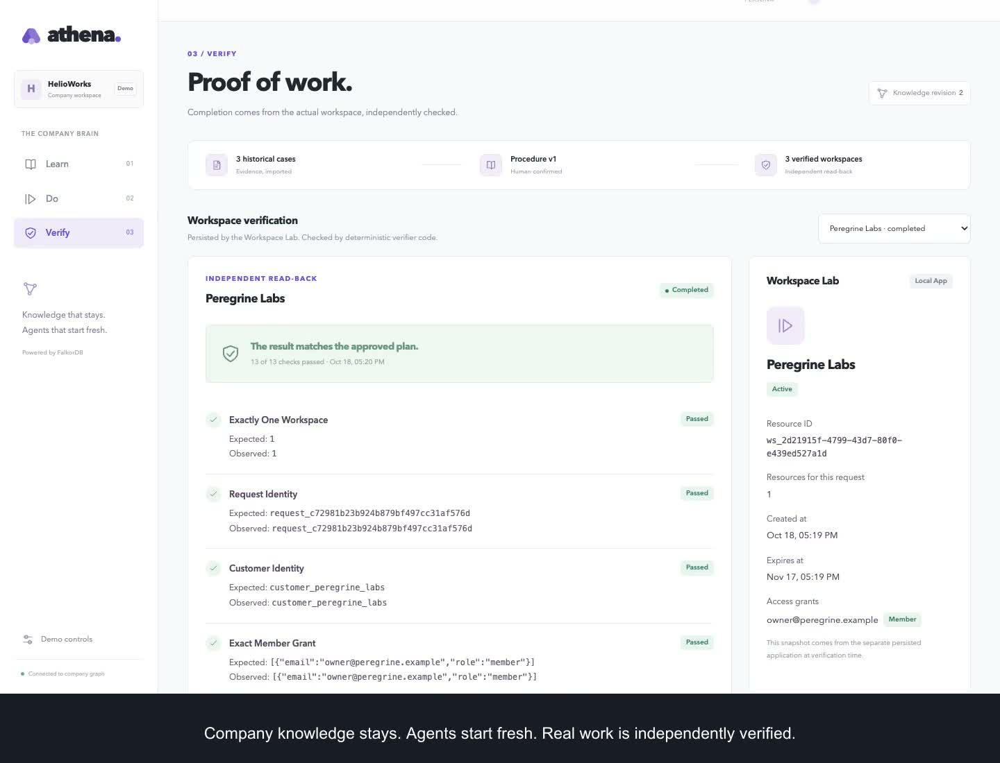
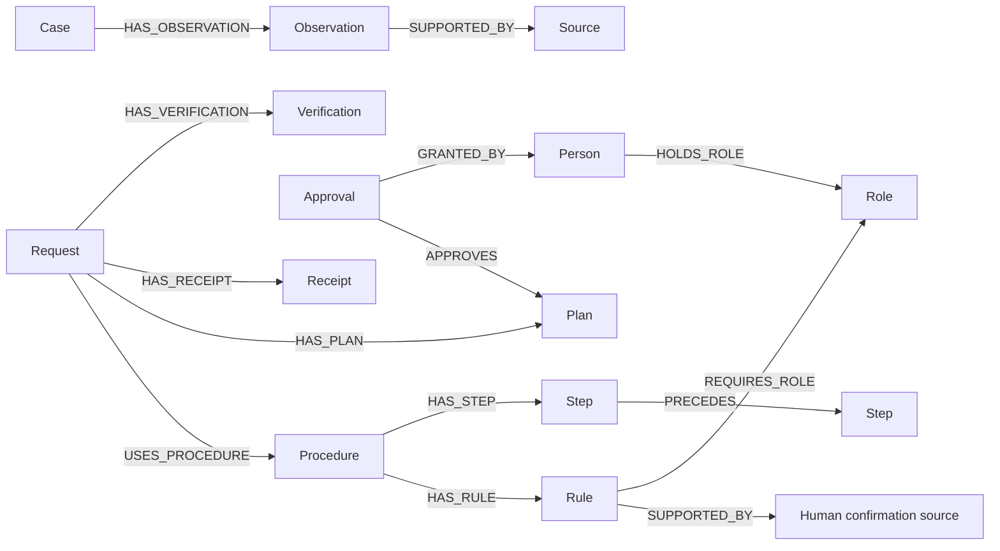

# Athena

**Teach the company once. Equip the next agent to get the job done.**

HelioWorks gives customers trial workspaces. Its past records show both seven-day and thirty-day trials, but those examples do not explain what the next customer should receive. Athena reads the evidence, asks a person to confirm the policy, and saves it in FalkorDB. A new agent can then use that policy, find the right approver, create a trial workspace, and check that it was set up correctly.

Track: **Company Brain / Track 03**, WeMakeDevs × FalkorDB Graph Hacks, October 2026.

**[Try Athena live](https://athena-0gfk.onrender.com)** · **[Watch the 3:11 video](https://fuadsn.github.io/athena/)** · [Download MP4](docs/demo/athena-demo.mp4) · [Measured live evidence](docs/live-evidence.json) · [Validation](docs/validation.md)

The public demo runs on Render Free with real FalkorDB and OpenAI. Enter the access code supplied with the submission. Free hosting may take about a minute to wake and resets demo data on restart. Hosting and model selection are independent; model calls use the selected provider's billing. [Hosting details](docs/hosting.md) · [Public deployment evidence](docs/hosted-evidence.json).

[](https://fuadsn.github.io/athena/)

Validated with three consecutive live-model rehearsals, nine independently verified requests, 85 unit tests, 68 integration tests, the complete live browser flow, and a full Docker Compose check. The public deployment also passed the complete live browser flow with three verified workspaces. [CI results](https://github.com/fuadsn/athena/actions).

## Try the demo

Open the **[live app](https://athena-0gfk.onrender.com)** and enter the access code supplied with the submission, or **[watch the 3:11 recording](https://fuadsn.github.io/athena/)**. The app has three tabs: **Learn** teaches a policy, **Do** carries out a request, and **Verify** checks the actual workspace.

You play four people using the **Demo persona** dropdown at the top. Switching people demonstrates who is allowed to teach, request, or approve work.

| Person | Their part in the demo |
|---|---|
| **Mira** — process owner | Reviews the evidence, publishes the policy, and changes who may approve extensions |
| **Ana** — trial operator | Requests a new customer's workspace |
| **Ravi** — initial approver | Approves extended trials |
| **Leena** — replacement approver | Takes over approval when Mira changes the role assignment |

### 1. Teach Athena the policy

Enter as **Mira**. In **Learn**, open **Read source** on a case to see the original evidence. Click **Learn from these cases** and wait for the model to finish. It compares the cases and asks what should become reusable policy.

For this walkthrough, review and enter these settings:

| Field | Demo value |
|---|---|
| Normal trial duration | **7 days** |
| Extended trial duration | **30 days** |
| Workspace access | **Member** |
| Extension approval role | **Trial Extension Approver** |

Check all three confirmations, then click **Confirm & publish procedure**. **Expected result:** a published procedure and its human confirmation source. The values above are your teaching input; the historical cases do not automatically authorize future work.

If a procedure is already published, inspect it and continue with its confirmed values. This is a shared demo, so another visitor may have already completed the teaching step.

### 2. Request a workspace

Switch **Demo persona** to **Ana**, open **Do**, and enter:

- **Customer name:** `Atlas Robotics`
- **Workspace owner:** `owner@atlas.example`
- **Requested duration:** `30`

Click **Create trial request**. **Expected result:** Athena proposes the steps and waits for the current approver, initially Ravi. The workspace is not created before approval. Use a different customer name and email if you repeat the walkthrough.

### 3. Approve and inspect the result

Switch to the person named on the approval card and click **Approve this plan**. Wait for execution, then click **Inspect outcome**.

**Expected result:** **Verify** shows the workspace, member access, expiry, active state, and independent checks. Athena reads the resource back from the separate Workspace Lab before marking the request complete. These are real resources in a synthetic demo application, not accounts in a third-party SaaS product.

### 4. See why the graph matters

Switch to **Mira**. Open **Demo controls**, select **Trial Extension Approver**, assign **Leena**, and click **Update authority**. Return to **Ana** and submit a new 30-day request for `Orion Instruments`, `owner@orion.example`.

**Expected result:** the new request waits for **Leena**. Ravi can no longer approve it. The company relationship changed in FalkorDB; no prompt or application code changed. In **Activity & graph evidence**, open a `Q3_current_role_holder` entry's **Recorded details** to inspect the actual Cypher query.

For a shorter path, Ana can leave the duration blank to use the confirmed normal trial, which does not require extension approval in this walkthrough. The app's **How to try this demo** guide keeps these steps available while you work.

The video also shows a pending request becoming blocked when its approval authority changes. [Detailed recording script](docs/demo-script.md) · [Graph model and queries](#why-falkordb-matters).

## Run locally

Prerequisites: Node.js 24 LTS, npm, and either a running Docker daemon (Docker Desktop or Colima) or the embedded database option below. This is a local demo using synthetic identities and resources.

```sh
npm ci
npm run setup
```

Edit the ignored `.env` and set `OPENAI_API_KEY` and `OPENAI_MODEL` to a model available to your account that supports strict Responses function calling. Setup generates separate random session, Lab write, and Lab administrative credentials. Keep those local; never commit `.env`.

The recorded release uses `OPENAI_MODEL=gpt-5.4-2026-03-05`. Earlier attempts with the mini model had intermittent induction failures; the [validation record](docs/validation.md) preserves those results.

```sh
docker compose up -d graph
npm run seed
npm run dev
```

Open **http://127.0.0.1:3100**. The runtime listens on port 4100, the independent Lab on 4200, and FalkorDB on 16379. Choose a synthetic persona in the interface. The runtime seeds historical evidence idempotently on startup; `seed` is also available explicitly.

On macOS with Colima installed but stopped, run `colima start --cpu 4 --memory 4` first. If Docker still selects a missing Desktop socket, select the running Colima context with `docker context use colima`.

On Apple Silicon macOS or Linux x64, the official [FalkorDBLite package](https://github.com/FalkorDB/falkordblite-ts) can start a real local FalkorDB without Docker:

```sh
npm run dev -- --embedded
```

This starts all four services, persists graph data in `.local/graph` with append-only writes, and binds the database to host loopback. It requires an empty `FALKORDB_PASSWORD`; do not run it alongside the Docker database on the same port. The embedded package is pinned to 0.3.0 and requests FalkorDB 4.18.3. This Mac used the installed Redis 8.4.0 and Homebrew `libomp`; if the platform package cannot supply Redis, install those platform prerequisites or use Docker. The container deployment separately pins FalkorDB 4.22.1, so embedded checks do not establish that the container image has been tested.

To run all four services in containers:

```sh
docker compose up --build
```

The compose services expose the web and runtime only on host loopback; the Lab is internal. Graph and Lab data have separate persistent volumes. The image tag and multi-architecture digest are pinned in `compose.yaml`. Restart services after changing model configuration.

For recording and production browser checks, stop the development command, then run:

```sh
npm run build
npm run preview -- --embedded
```

`preview` runs the built web interface with the same runtime and Lab, without development controls or hot reload. Omit `--embedded` when the database is already running separately. Both modes use the same saved local graph and Lab data.

To capture a new working video after live verification, run `npm run demo:record`. It records the actual flow, including model waits, under `.local/demo-recordings/`. See [capture instructions](docs/demo-script.md#capture-the-working-flow).

## Why FalkorDB matters

The runtime uses relationship queries to retrieve evidence, assemble the reviewed procedure and its dependency graph, resolve current role assignments, validate approvals, and recover receipts. It cannot execute from a local procedure snapshot when the graph is unavailable.



[Graph model](docs/graph-model.md) · [Essential Cypher queries](docs/queries.md) · [Shared decisions](docs/decisions.md)

The graph changes what the agent is allowed to do:

| Decision | Graph traversal | Observable result |
|---|---|---|
| What can be reused? | Case → observation → source; then published procedure → confirmed rules and steps | Historical success alone never authorizes a new workspace. A cold graph blocks work until the owner publishes policy. |
| Which action comes next? | Procedure → steps; step → prerequisite through `PRECEDES` | The executor reconstructs dependencies from relationships and configures access and expiry before activation. |
| Who may approve now? | Rule → required role ← person with a currently valid `HOLDS_ROLE` assignment | Replacing Ravi with Leena changes fresh routing and invalidates unused stale approvals without changing the prompt. |
| Does this approval authorize this action? | Request → plan ← approval → actor, joined to current role authority | Every Lab mutation rechecks the exact plan hash and current knowledge/assignment revisions. |
| Did the action really succeed? | Request → receipts and verification, reconciled with the separate Lab | A graph receipt is checked against the persisted workspace, access decisions, expiry, and resource count before completion. |

The runnable queries are in [the graph adapter](packages/graph/src/queries.ts). [Real-database tests](packages/graph/test/graph.integration.test.ts) remove relationships to verify that retrieval follows the graph; [runtime integration tests](tests/integration/runtime.test.ts) exercise changed authority, graph outages, and interrupted-work recovery. These checks use an explicit test model. Live-model rehearsal status is reported separately in [validation](docs/validation.md).

## Architecture

| Component | Responsibility |
|---|---|
| `apps/web` | Next.js interface and same-origin runtime proxy |
| `apps/runtime` | Signed demo sessions, dispatcher, fresh episodes, serialized mutations |
| `packages/graph` | FalkorDB queries, immutable evidence, procedure and authority storage |
| `packages/learner` | Live Responses tool adapter and bounded, cited procedure induction |
| `packages/executor` | Rule evaluation, plan hashing, current-authority guards, execution and verification |
| `apps/workspace-lab` | Independent atomic file store, durable operations, actual access/expiry behavior |

The model proposes a procedure and eligible actions. Code validates evidence, authorizes publication and exact plans, performs actions, and determines completion. The engine traverses the reviewed step dependencies; duration and approval requirements come from confirmed graph rules.

`fixtures/company-history.json` is the only runtime input fixture. Its directory authority and historical observations are synthetic. It contains no executable procedure, plan, rule, or reusable approval. `evals/acceptance.json` contains test expectations and explicit human teaching inputs; it is excluded from runtime imports and the Docker image.

## Validation

```sh
npm test
npm run typecheck
npm run build
npm run test:integration
npm run test:e2e
npm run eval:live
```

- `test` exercises contracts, evidence checks, bounded model handling, executor guards, and real file-backed Lab behavior. Model and graph doubles are confined to tests.
- `test:integration` requires real FalkorDB and runs graph queries, HTTP Lab checks, and the complete service flow. It uses unique test graphs and temporary Lab files; it does not reset the demo graph.
- `test:e2e` includes the live headline flow and requires the three application services and a configured live model. Install the Chromium test browser with `npx playwright install chromium`, or set `PLAYWRIGHT_CHROMIUM_EXECUTABLE` to an existing Chrome executable and install the small video helper with `npx playwright install ffmpeg`. The headline flow resets the demo through its owner-authorized API.
- `npm run test:e2e -- cold.spec.ts` verifies actual browser entry, source inspection, mobile layout, and origin guards without calling a model. It can run while API credentials are still being configured.
- `eval:live` performs three consecutive reset-to-completion rehearsals against the running local runtime. It records real model identity, usage, episodes, queries, approvals, receipts, and verification under `.local/live-rehearsals/`. The harness submits its teaching input through the same explicit owner-review endpoint after live induction. A failed attempt remains recorded and cannot count as a pass.

See [validation status](docs/validation.md) for actual completed checks and remaining release requirements. Passing deterministic tests is not a substitute for the live release gate.

Reset the demo using the owner control or:

```sh
npm run demo:reset
```

Reset refuses to run while an episode is active, then resets the graph and Lab through the runtime's serialized control lane. Do not delete only one service's storage to reset the demo.

## Scope and limits

Athena implements one workflow for one synthetic company. Workspace Lab resources are persisted local demo resources; no cloud workspace or production account is provisioned. Verification checks customer identity, exact member grants, expiry derived from persisted creation time, active state, access decisions, receipts, and applicable approval.

The runtime is a single mutation writer. It is not a distributed transaction system. If a response is lost after a Lab commit, resume reconciles its durable receipt before retrying. Partial resources remain visible; there is no automatic deletion, reactivation, or access broadening.

The persona selector demonstrates role enforcement for four synthetic people. The [public hosted demo](docs/hosting.md) requires a private access code and signed HTTPS sessions; its runtime, database, and Lab listen only inside the container. The original local profile must remain on loopback. Render Free storage is ephemeral: sleeping, restarting, or redeploying starts a fresh demo from historical cases. This is a shared demonstration, not enterprise authentication or durable company hosting.

## AI assistance and participant review

OpenAI Codex assisted with implementation, testing, and documentation. The project owner supplied the product specification and selected the problem and track. See [the assistance disclosure](docs/ai-assistance.md). The project owner has personally reviewed the code and working demonstration.
