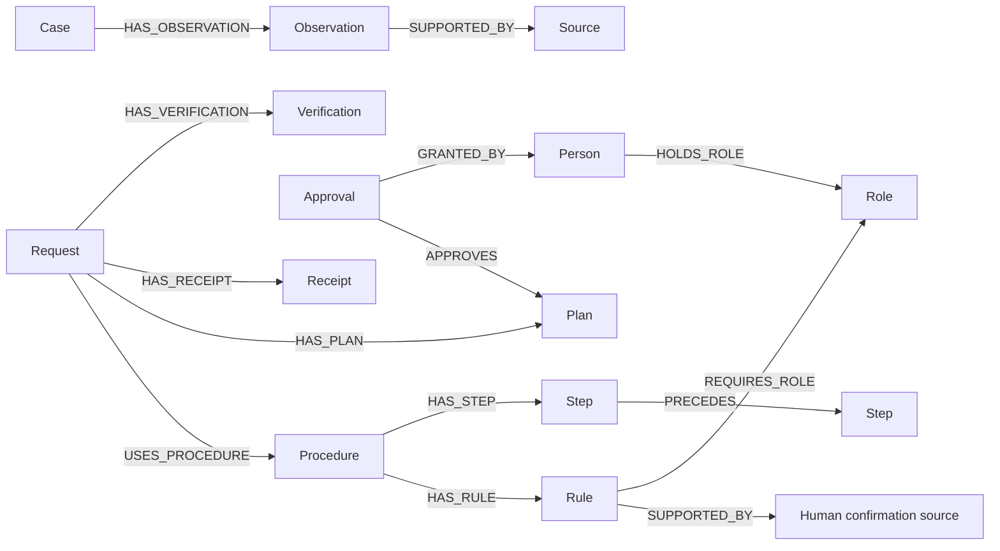

# Athena

**Teach the company once. Equip the next agent to get the job done.**

Athena learns a proposed trial-workspace procedure from three synthetic company cases, asks the process owner to resolve uncertainty, and stores the reviewed capability in FalkorDB. A fresh agent retrieves that procedure and current authority, obtains any required approval, creates a persisted resource in a separate Workspace Lab, and verifies the result.

Track: **Company Brain / Track 03**, WeMakeDevs × FalkorDB Graph Hacks, October 2026.

## Run locally

Prerequisites: Node.js 24 LTS, npm, and either a running Docker daemon (Docker Desktop or Colima) or the embedded database option below. This is a local demo using synthetic identities and resources.

```sh
npm ci
npm run setup
```

Edit the ignored `.env` and set `OPENAI_API_KEY` and `OPENAI_MODEL` to a model available to your account that supports strict Responses function calling. Setup generates separate random session, Lab write, and Lab administrative credentials. Keep those local; never commit `.env`.

```sh
docker compose up -d graph
npm run seed
npm run dev
```

Open **http://127.0.0.1:3100**. The runtime listens on port 4100, the independent Lab on 4200, and FalkorDB on 16379. Choose a synthetic persona in the interface. The runtime seeds historical evidence idempotently on startup; `seed` is also available explicitly.

On macOS with Colima installed but stopped, run `colima start --cpu 4 --memory 4` first. If Docker still selects a missing Desktop socket, select the running Colima context with `docker context use colima`.

On Apple Silicon macOS or Linux x64, the official [FalkorDBLite package](https://github.com/FalkorDB/falkordblite-ts) can start a real local FalkorDB without Docker:

```sh
npm run dev -- --embedded
```

This starts all four services, persists graph data in `.local/graph` with append-only writes, and binds the database to host loopback. It requires an empty `FALKORDB_PASSWORD`; do not run it alongside the Docker database on the same port. The embedded package is pinned to 0.3.0 and requests FalkorDB 4.18.3. This Mac used the installed Redis 8.4.0 and Homebrew `libomp`; if the platform package cannot supply Redis, install those platform prerequisites or use Docker. The container deployment separately pins FalkorDB 4.22.1, so embedded checks do not establish that the container image has been tested.

To run all four services in containers:

```sh
docker compose up --build
```

The compose services expose the web and runtime only on host loopback; the Lab is internal. Graph and Lab data have separate persistent volumes. The image tag and multi-architecture digest are pinned in `compose.yaml`. Restart services after changing model configuration.

For recording and production browser checks, stop the development command, then run:

```sh
npm run build
npm run preview -- --embedded
```

`preview` runs the built web interface with the same runtime and Lab, without development controls or hot reload. Omit `--embedded` when the database is already running separately. Both modes use the same saved local graph and Lab data.

## Demonstration

1. Enter as **Mira**, the process owner. Show three historical cases and no published procedure.
2. Start learning. Inspect actual source excerpts and the model's question about the different trial lengths.
3. Review the structured fields and confirm the reusable policy. Publishing creates an immutable version and a new human source.
4. Switch to **Ana**, the trial operator, and request a new extended trial. Show the paused request and exact plan hash.
5. Switch to the current approver, initially **Ravi**, and approve. Inspect the fresh episode, real receipts, and independent verification.
6. As Mira, assign the extension role to **Leena**. A new request routes to Leena; Ravi cannot approve it.
7. Review a new version with a nine-day normal duration. A default request uses that new value without code or prompt changes.

An approval wait ends its model episode. Resuming starts a new episode with empty model history and fresh graph retrieval. A rejected request cannot resume. Other unsupported durations require clarification.

See [the demo script](docs/demo-script.md) for the recording sequence. A video and public repository URL must be added before submission; they have not been published by this checkout.

After live verification, `npm run demo:record` captures the actual headline flow as a WebM video under `.local/demo-recordings/`. It preserves failed recordings too; only a passing, reviewed recording should be used for submission.

## Why FalkorDB matters

The runtime uses relationship queries to retrieve evidence, assemble the reviewed procedure and its dependency graph, resolve current role assignments, validate approvals, and recover receipts. It cannot execute from a local procedure snapshot when the graph is unavailable.



[Graph model](docs/graph-model.md) · [Essential Cypher queries](docs/queries.md) · [Shared decisions](docs/decisions.md)

The graph changes what the agent is allowed to do:

| Decision | Graph traversal | Observable result |
|---|---|---|
| What can be reused? | Case → observation → source; then published procedure → confirmed rules and steps | Historical success alone never authorizes a new workspace. A cold graph blocks work until the owner publishes policy. |
| Which action comes next? | Procedure → steps; step → prerequisite through `PRECEDES` | The executor reconstructs dependencies from relationships and configures access and expiry before activation. |
| Who may approve now? | Rule → required role ← person with a currently valid `HOLDS_ROLE` assignment | Replacing Ravi with Leena changes fresh routing and invalidates unused stale approvals without changing the prompt. |
| Does this approval authorize this action? | Request → plan ← approval → actor, joined to current role authority | Every Lab mutation rechecks the exact plan hash and current knowledge/assignment revisions. |
| Did the action really succeed? | Request → receipts and verification, reconciled with the separate Lab | A graph receipt is checked against the persisted workspace, access decisions, expiry, and resource count before completion. |

The runnable queries are in [the graph adapter](packages/graph/src/queries.ts). [Real-database tests](packages/graph/test/graph.integration.test.ts) remove relationships to verify that retrieval follows the graph; [runtime integration tests](tests/integration/runtime.test.ts) exercise changed authority, graph outages, and interrupted-work recovery. These checks use an explicit test model. Live-model rehearsal status is reported separately in [validation](docs/validation.md).

## Architecture

| Component | Responsibility |
|---|---|
| `apps/web` | Next.js interface and same-origin runtime proxy |
| `apps/runtime` | Signed demo sessions, dispatcher, fresh episodes, serialized mutations |
| `packages/graph` | FalkorDB queries, immutable evidence, procedure and authority storage |
| `packages/learner` | Live Responses tool adapter and bounded, cited procedure induction |
| `packages/executor` | Rule evaluation, plan hashing, current-authority guards, execution and verification |
| `apps/workspace-lab` | Independent atomic file store, durable operations, actual access/expiry behavior |

The model proposes a procedure and eligible actions. Code validates evidence, authorizes publication and exact plans, performs actions, and determines completion. The engine traverses the reviewed step dependencies; duration and approval requirements come from confirmed graph rules.

`fixtures/company-history.json` is the only runtime input fixture. Its directory authority and historical observations are synthetic. It contains no executable procedure, plan, rule, or reusable approval. `evals/acceptance.json` contains test expectations and explicit human teaching inputs; it is excluded from runtime imports and the Docker image.

## Validation

```sh
npm test
npm run typecheck
npm run build
npm run test:integration
npm run test:e2e
npm run eval:live
```

- `test` exercises contracts, evidence checks, bounded model handling, executor guards, and real file-backed Lab behavior. Model and graph doubles are confined to tests.
- `test:integration` requires real FalkorDB and runs graph queries, HTTP Lab checks, and the complete service flow. It uses unique test graphs and temporary Lab files; it does not reset the demo graph.
- `test:e2e` includes the live headline flow and requires the three application services and a configured live model. Install the Chromium test browser with `npx playwright install chromium`, or set `PLAYWRIGHT_CHROMIUM_EXECUTABLE` to an existing Chrome executable and install the small video helper with `npx playwright install ffmpeg`. The headline flow resets the demo through its owner-authorized API.
- `npm run test:e2e -- cold.spec.ts` verifies actual browser entry, source inspection, mobile layout, and origin guards without calling a model. It can run while API credentials are still being configured.
- `eval:live` performs three consecutive reset-to-completion rehearsals against the running local runtime. It records real model identity, usage, episodes, queries, approvals, receipts, and verification under `.local/live-rehearsals/`. The harness submits its teaching input through the same explicit owner-review endpoint after live induction. A failed attempt remains recorded and cannot count as a pass.

See [validation status](docs/validation.md) for actual completed checks and remaining release requirements. Passing deterministic tests is not a substitute for the live release gate.

Reset the demo using the owner control or:

```sh
npm run demo:reset
```

Reset refuses to run while an episode is active, then resets the graph and Lab through the runtime's serialized control lane. Do not delete only one service's storage to reset the demo.

## Scope and limits

Athena implements one workflow for one synthetic company. Workspace Lab resources are persisted local demo resources; no cloud workspace or production account is provisioned. Verification checks customer identity, exact member grants, expiry derived from persisted creation time, active state, access decisions, receipts, and applicable approval.

The runtime is a single mutation writer. It is not a distributed transaction system. If a response is lost after a Lab commit, resume reconciles its durable receipt before retrying. Partial resources remain visible; there is no automatic deletion, reactivation, or access broadening.

The persona selector demonstrates role enforcement within an explicitly local demo. Do not expose it, the reset endpoint, or the Lab directly to the public internet. Hosted deployment is outside this version's scope.

## AI assistance and participant review

OpenAI Codex assisted with implementation, testing, and documentation. The project owner supplied the product specification and selected the problem and track. See [the assistance disclosure](docs/ai-assistance.md). Participant code inspection, hands-on demonstration, and submission review remain explicit release requirements.
