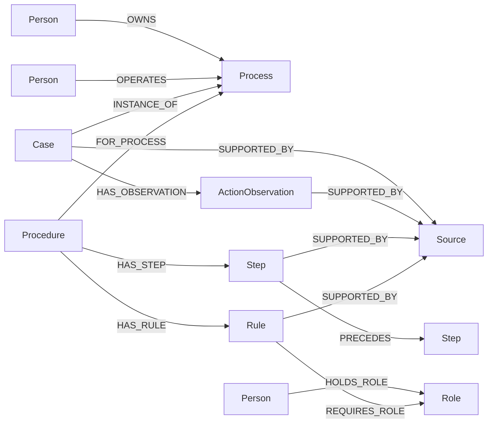
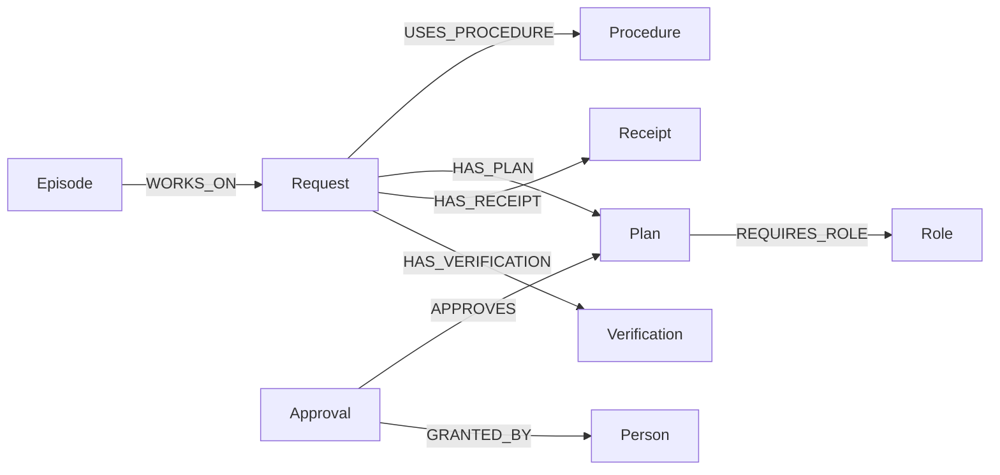

# FalkorDB knowledge and execution model

FalkorDB is Athena's authoritative company store. Historical source text, reviewed procedure structure, current authority and work records are graph data. The Workspace Lab persists workspace business state separately; verification reads that service.

## History is evidence, not executable policy

Import creates `Person`, `Role`, `Process`, `Case`, `ActionObservation`, `Source` and one `Metadata` node. It creates no procedure, rule, step, plan or reusable approval. A historical consent remains inside its case record and source text.

Every source has a stable `id`, positive revision, exact UTF-8 SHA-256 content hash, timestamp, authors and immutable text. Its internal graph key is `id@revision`. A citation must match an existing revision and contain a literal substring or a real observation/audit-event ID linked to that source. Source authors and directory relationships are validated during ingestion. Reimporting the same dataset is idempotent; altering an existing source is rejected.

## Reviewed procedure versions

A model returns a proposed candidate. The runtime owns all graph mutations and requires the process owner's explicit structured review before publication. The source recording that review must be authored by the owner. Every published rule and step links to its historical evidence and the new owner confirmation through `SUPPORTED_BY` edges. These edges retain source ID, source revision, a serialized exact evidence reference, and a `confirmation` flag.

`Procedure` has a stable version ID, version number, publication status and knowledge revision. A step/rule's internal key is `procedureId/localId`, preventing version collisions. `HAS_STEP`, `PRECEDES`, `HAS_RULE`, `REQUIRES_ROLE` and source relationships supply executable structure during retrieval. Serialized record properties preserve the rest of the validated record, including parameters and conditions. A missing relationship is not restored from a serialized snapshot.

Published versions cannot be edited in place. Publishing a new version marks the old version `SUPERSEDED`, creates the new confirming source and immutable structure, and increments `Metadata.knowledgeRevision`. The revision comparison and publication execute in one graph statement; a stale expected revision fails. Old plans retain their original procedure IDs.

## Current authority

`Person-[:HOLDS_ROLE]->Role` stores assignment ID, assignment revision, ISO validity interval and source-backed assignment record. Authority resolution traverses that relationship and requires exactly one currently valid assignment. The person and role IDs come from the relationship endpoints, not duplicated JSON fields. Assignment evidence is validated before authority is returned.

Authority changes require the process owner, close existing current assignments, append an owner-authored source, add the new assignment and increment the global knowledge revision. This is a deliberately coarse invalidation scheme for the single-company demo. Removing the active role edge immediately removes the ability to resolve its approver.

## Work and independent verification

Plan records are immutable and bind request revision, procedure, knowledge revision, parameters, step structure, approval role and current assignment. Runtime guards validate the stored exact plan hash and re-resolve current authority before each mutating Lab operation. Approval nodes preserve the authenticated actor and exact plan hash.

Receipts use `requestId/stepId` as their stable storage identity. Request-to-receipt and request-to-verification relationships support restart reconciliation. Events have a graph-assigned monotonically increasing sequence. Ordinary work writes do not change knowledge revision.

There is one runtime mutation broker; GraphStore is not designed for concurrent independent writers. The P0 deployment is one company and one runtime process. Read failures return `DEPENDENCY_UNAVAILABLE`. There is no in-memory policy fallback, local graph snapshot fallback, or model-generated Cypher write tool.

Each database query has a five-second client deadline. A timed-out write may have committed even though its response was lost, so the adapter retires that connection and rejects every subsequent query. It does not automatically reconnect and replay a write. Restore database availability, restart the runtime to create a fresh connection, and resume the request; the existing plan, graph receipts and independent Lab operation ledger are reconciled before more mutations. Health/API requests report the dependency as unavailable until restart. Ordinary query errors also fail closed; they never select a cached procedure.

The episode's active-time limit remains separate from query tracing. Model/evidence waits are bounded, and the executor checks its abort signal before dispatching each Lab mutation. Failure-record persistence is still allowed after an episode deadline when the graph remains healthy. If the graph itself is unavailable, the runtime may be unable to persist a new failure event; it does not invent a successful completion.

## Validation

`packages/graph/test/evidence.test.ts` checks source hashes, fabricated citations, dangling history references, cold import boundaries and unavailable dependencies. `packages/graph/test/graph.integration.test.ts` runs isolated real-FalkorDB relationship tests when `GRAPH_INTEGRATION=1` is set. These tests use a uniquely named graph and delete only that test graph on completion. Test-only confirmed procedure fixtures never enter runtime imports or prompts.
