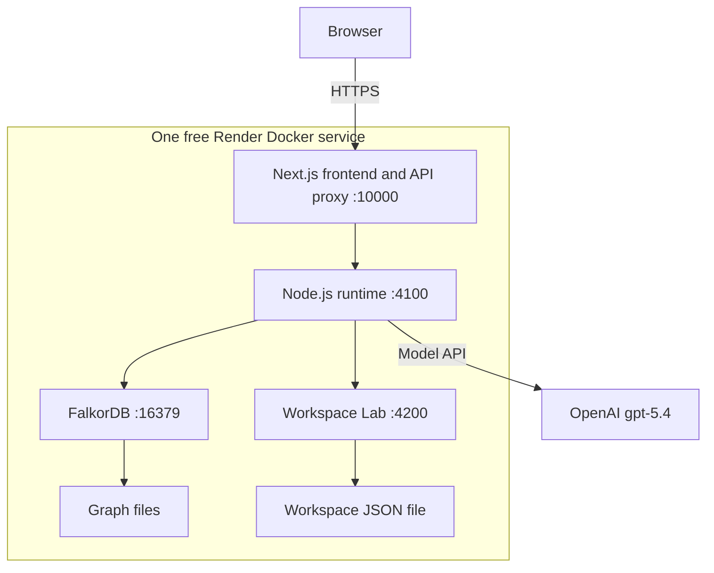

# Free hosted demonstration

**Live app: [athena-0gfk.onrender.com](https://athena-0gfk.onrender.com).** Enter the access code supplied with the submission. The public deployment passed the complete live browser rehearsal on 18 October 2026: learning, owner confirmation, normal and extended requests, changed approval authority, and three independently verified workspaces. [Recorded public evidence](hosted-evidence.json).

The hosted profile targets a **Render Free web service**, with the frontend, runtime, separate Workspace Lab process, and real embedded FalkorDB in one container. Only the web port is public. This is a shared hackathon demonstration, not durable company hosting.

Hosting and model selection are independent. The Blueprint defaults to `MODEL_PROVIDER=openai` and `OPENAI_MODEL=gpt-5.4-2026-03-05`, the configuration used by the published recording and live evidence. Render hosting is free; OpenAI API calls use the owner's existing credits. Only the runtime receives the selected provider's key. There is no automatic provider fallback.

## What is running on Render

The deployed service is named **athena**, in **Frankfurt**, on the **Free** plan with one instance. Render builds `Dockerfile.hosted` from the public repository. Automatic deployment is off, so documentation pushes do not restart the application and discard its demo state. Application releases are deployed explicitly.



| Component | Responsibility | Exposure and storage |
|---|---|---|
| Next.js / React frontend | Learn, Do, Verify, persona selection, source inspection; forwards allowed API routes to the runtime | Public HTTPS, with Render terminating TLS and forwarding to port 10000 |
| Node.js runtime | Model episodes, evidence validation, procedure publication, approval checks, execution, and independent verification | Private loopback port 4100; only this process receives the selected model API key |
| FalkorDB | Sources, observations, procedures, rules, step dependencies, people and authority, requests, approvals, and execution evidence | Private loopback port 16379; embedded FalkorDB 4.18.3, graph `athena`, files under `/app/.local/hosted/graph` |
| Workspace Lab | Creates and updates actual synthetic trial-workspace resources; provides independent read-back and operation receipts | Private loopback port 4200; `/app/.local/hosted/workspaces.json`; separate internal write/admin tokens generated at boot |
| OpenAI | Proposes procedures and eligible actions through the model adapter | External API using the owner's existing key and `gpt-5.4-2026-03-05`; separate from Render hosting charges |

The graph uses append-only writes, but **neither graph nor Lab storage has a persistent Render disk**. Both stores survive ordinary requests and separate agent episodes while the instance is running. They are lost on sleep, restart, or redeployment. No external database, object store, or backup service is configured. Startup imports historical cases only; teaching and execution happen through the application.

`scripts/hosted.ts` starts the graph, waits for the Lab and runtime health checks, and then starts the frontend. It stops the other processes if one fails. Render checks `/`; the runtime's API health check also checks the graph. Sessions use signed, secure, HttpOnly cookies. Demo access is shared with judges; the four personas remain synthetic and are not connected to a company identity provider.

GitHub Actions runs the build, tests, and container/browser checks on temporary GitHub runners. It does not host the application and has no model key. GitHub Pages separately hosts the recorded video and the link to the live app. The Render API key was used only by local deployment tooling and is not an application environment variable.

## Deploy

1. Create a free [Render account](https://dashboard.render.com).
2. Open [Deploy Athena to Render](https://render.com/deploy?repo=https://github.com/fuadsn/athena). The checked-in `render.yaml` explicitly sets `plan: free`; do not select an upgrade.
3. Supply the existing `OPENAI_API_KEY` and a random `DEMO_ACCESS_CODE` of at least 16 characters. Keep both out of Git. Render generates the session-signing secret. The access code is shared privately with judges in the submission.
4. Deploy. Render's `RENDER_EXTERNAL_URL` selects the one accepted HTTPS origin. The public link is the URL Render returns; no deployment is claimed until that URL has been checked.
5. Open the URL, enter the access code, and run the complete Learn → Confirm → Do → Verify flow. Inspect an actual graph query and repeat the authority-change demonstration.

Dashboard deployment does **not** require a Render API key. For automated deployment, the owner may supply `RENDER_API_KEY` through the ignored local `.env`. That key lets deployment tooling create and manage the service in the owner's account; Athena does not use it and it must never be sent to the hosted application.

## Limits and access

- Render's Free web service has 512 MB RAM and 0.1 CPU. The hosted CI job builds this image and exercises entry through HTTPS under those limits, without a model key. Check the actual job result before calling the hosted package verified.
- Free services sleep after 15 minutes idle. Restarting, redeploying, or sleeping discards local graph and Lab files. The next start seeds historical evidence only; it does not fabricate a published procedure or successful request.
- A valid access code creates a signed, secure session. Within that demonstration, the user can select the four synthetic personas and exercise their distinct permissions. This is demonstration access, not enterprise identity management.
- A shared allowance permits at most 120 model turns per hour and one model call at a time. Failed provider calls consume the allowance. This is a request limit, not a dollar spending cap; the selected provider's billing and quotas still apply. Resetting graph data does not reset the process's allowance.
- Never reuse the local service credentials pasted into chat for hosting. Internal Lab credentials are freshly generated at startup; the hosted session secret and entry code are separate.
- Keep the public recording available as a fallback while the free service wakes or is out of quota.

Official references: [Render Free limitations](https://render.com/docs/free), [Render Blueprint configuration](https://render.com/docs/blueprint-spec), and [OpenAI API pricing](https://developers.openai.com/api/docs/pricing).

## Observed model cost

An audit on 18 October 2026 deduplicated episode IDs across the preserved rehearsal JSON and the current recording graph. At standard uncached token rates, those recorded calls estimate to **$1.87 USD**:

| Recorded model | Input tokens | Output tokens | Estimated cost |
|---|---:|---:|---:|
| Earlier `gpt-5.4-mini-2026-03-17` experiments | 694,105 | 76,151 | $0.86 |
| Selected `gpt-5.4-2026-03-05` | 289,722 | 18,992 | $1.01 |

Within that total, the three final rehearsals used 223,424 input and 15,232 output tokens: **$0.79**, about **$0.26 per full rehearsal**. These are usage-based estimates, not the account bill: caching can reduce charges and calls without saved counters are excluded. The provider's usage dashboard is authoritative. CI has no model key and makes no paid model calls.

## Model portability

Learning and planning depend on the `ModelAdapter` interface, not a provider SDK. The graph, procedure schemas, approval checks, execution, and independent verification are shared across adapters. Provider-specific conversation formats and credentials stay in the adapter layer.

Current adapters are OpenAI Responses and Gemini's Chat Completions compatibility endpoint. OpenAI has passed three consecutive full live rehearsals. Gemini has HTTP-boundary tests, including tool-result continuation and opaque thought signatures, but has not had a live rehearsal. Other APIs need an adapter implementing the same contract; this is not a claim that every model works without integration or validation. Models must reliably support structured tool calls.

To select Gemini, change `MODEL_PROVIDER` to `gemini` and supply `GEMINI_API_KEY` and `GEMINI_MODEL`; remove the unused OpenAI key. Model selection never changes the hosting plan. Gemini's free tier is optional and is not required for this deployment.

## Local commands

The original development and Compose commands continue to work. To use Gemini locally, set:

```dotenv
MODEL_PROVIDER=gemini
GEMINI_MODEL=gemini-3.8-flash
GEMINI_API_KEY=your_private_key
```

The hosted container is built with `docker build -f Dockerfile.hosted -t athena-hosted .`. It requires a configured HTTPS origin, an access code, and TLS termination by the host. `scripts/hosted.ts` binds the internal services to loopback and starts the web listener on `PORT` (default 10000). Local data is stored under `.local/hosted`; its lifetime depends on the hosting filesystem.
